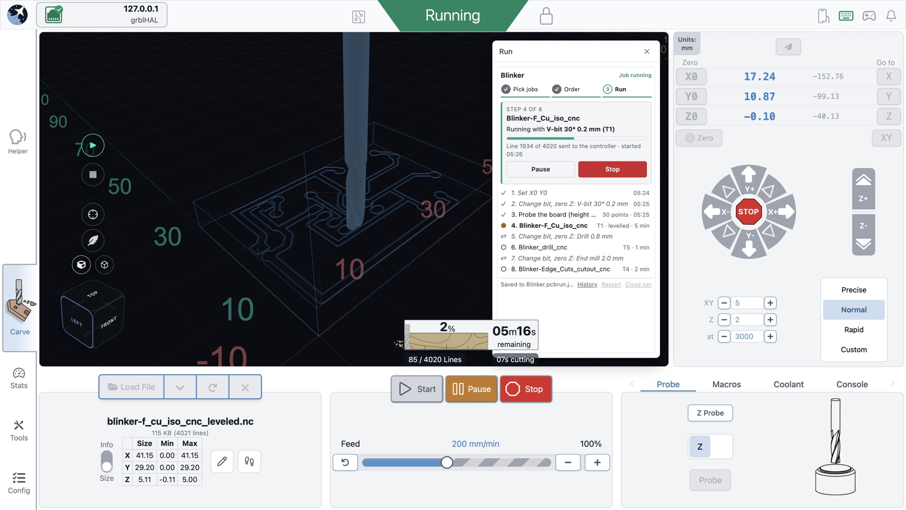
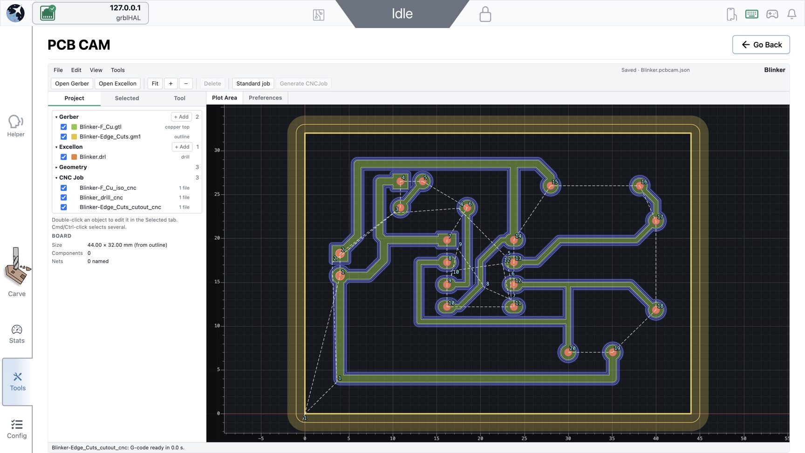
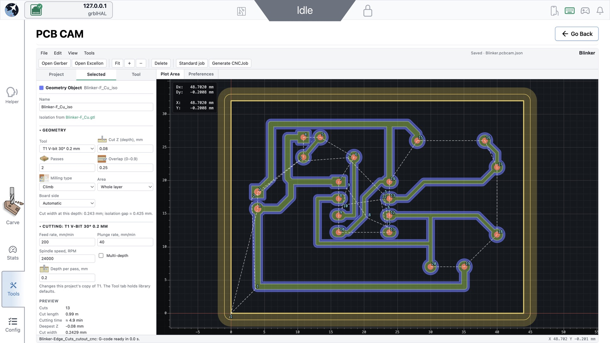
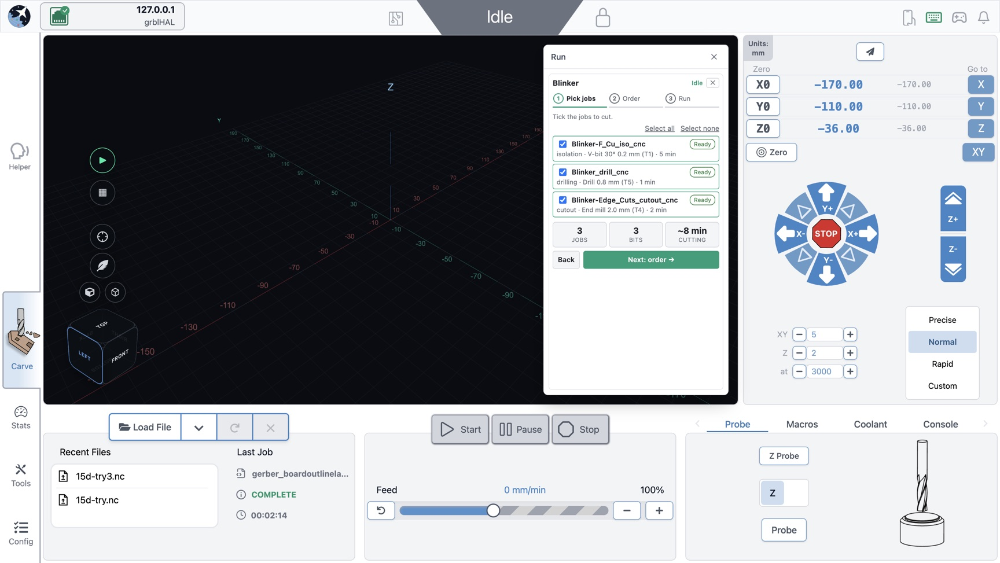
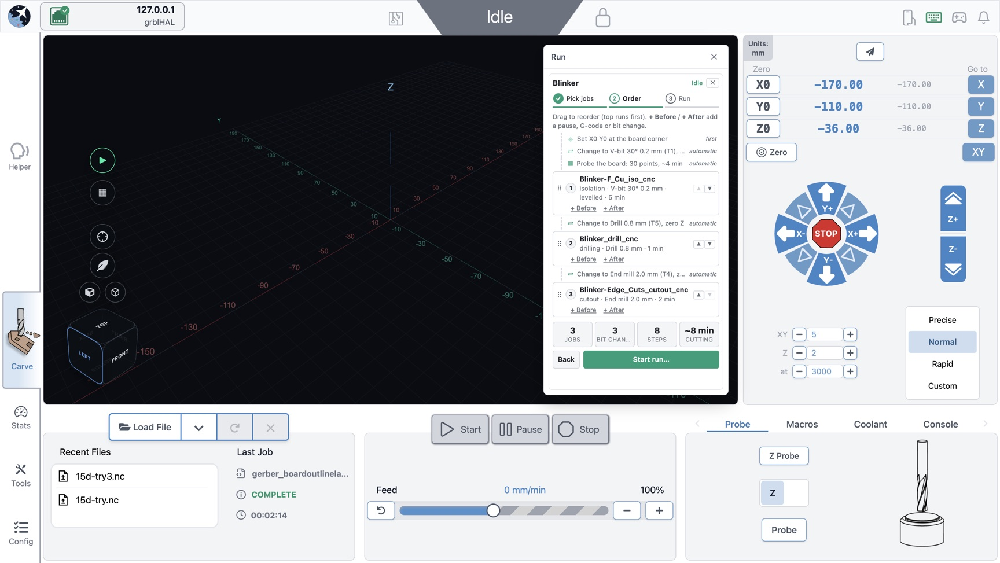
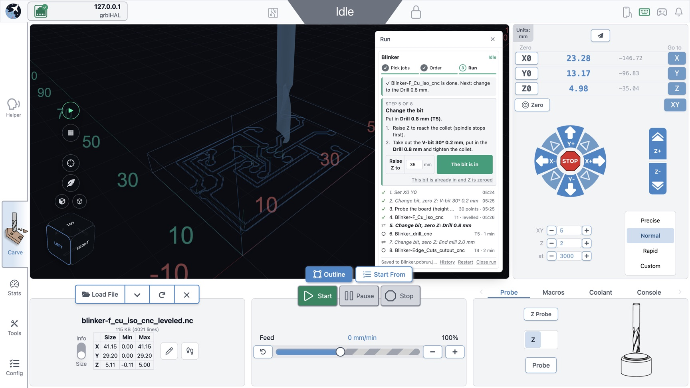
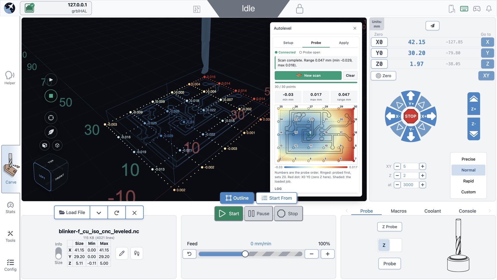

<p align="center">
  
</p>

# gSender PCB Plugins

Plugins for [gSender](https://github.com/Sienci-Labs/gsender) that turn a hobby CNC into a PCB mill. Open your board's Gerber and drill files, review the toolpaths, then let gSender walk you through the whole board: bit changes, zeroing Z, levelling and every job, one guided step at a time.

**Goal:** someone new to the hobby imports their board files, clicks through the prompts, and mills a working board. Every default is chosen for tools and materials that are easy to buy: 3018/3020-class machines, single-sided FR4/FR1 copper-clad, and V-bits, drills and end mills from common kits. The plugins are built to prevent mistakes rather than document them.

> Requires gSender **1.6+** with plugin support (tested on 1.7.0 Edge). Works with Grbl and grblHAL controllers. Boards have been milled with it on a 3020 running Grbl 1.1f.

<p align="center">
  
  <br><em>Project Runner cutting a levelled isolation job. The run list shows what is done and what comes next.</em>
</p>

| | |
|---|---|
|  |  |
| **PCB CAM:** Gerber and Excellon in, toolpaths and G-code out, in a FlatCAM-style workspace. | **Isolation settings:** the bit's real cut width at this depth, passes, overlap, and a time preview. |
|  |  |
| **Pick jobs:** open the project; each job is checked against what you reviewed in PCB CAM. | **Order:** bit changes, Zero Z and board probing are added for you. Drag to reorder. |
|  |  |
| **Bit change:** raise Z, swap the bit, then a guided Zero Z on the copper at X0 Y0. | **Autoleveler:** a probed height map, drawn live on the 3D visualizer, with a heat map. |

## Features

### 🧭 PCB CAM: board files → G-code
- 📂 Opens Gerber and Excellon from KiCad, EasyEDA, Eagle and Altium.
- 🔍 Detects each layer for you.
- ✏️ Isolation with V-bits or end mills, sized from the bit's real cut width.
- 🧹 Copper clearing.
- 🕳️ Drilling: drill, peck, or mill holes and slots.
- ✂️ Board cutout with holding tabs.
- 🎯 Different bits for different areas of the board.
- 🔄 Top or bottom side, mirrored for you.
- 🧰 Tool library with common kit bits.
- 👀 Toolpath preview, drill order, cut length and time.
- 💾 Projects autosave to disk.
- 📤 One click loads a job into gSender.

### ▶️ Project Runner: mill the whole board
- 🪄 Three steps: pick jobs, order, run.
- 🛑 Refuses jobs changed since you reviewed them.
- 🔧 Adds bit changes for you.
- 📏 Guided Zero Z on the copper at X0 Y0.
- 🪛 Tests the probe clip before it probes.
- 🗺️ Probes one height map per board.
- 📐 Levels each copper job exactly once.
- 🚧 Blocks a levelled job if X0 Y0 moved.
- ⏯️ Stopped probing picks up where it left off.
- 📝 Add your own pauses, notes or G-code.
- ✅ Tracks every job: done, cancelled, failed.
- 🔁 Restart keeps history and the height map.
- 🔒 Start stays locked until the machine is ready.

### 📊 Autoleveler: probe and level any job
- 📍 Probes a grid over the loaded job.
- 🌈 Live height points on the 3D view.
- 🔥 Heat map with min, max and range.
- 〰️ Levels any G-code, arcs included.
- ⏯️ Resumes a stopped scan.
- 📁 Import and export height maps.

### 🛡️ Safety first
- 🙋 You confirm every machine move.
- ⬇️ Probing never goes more than 1 mm too deep.
- 💬 Short messages that say what to do next.
- 🧠 Memory stays flat on long jobs.

### 🛠️ For developers
- 🤖 grblHAL simulator that real gSender connects to.
- 💥 Fault injection: disconnect, reset, power cut, limit trip.
- 🌐 TCP-to-serial bridge for networked machines.

## Quick start

1. Install the three plugins (see [Install](#install)) and restart gSender.
2. **Tools → PCB CAM:** choose a projects folder, then drop in your board's Gerber and drill files. Click **Standard job** to get isolation, drilling and cutout with the default bits. Check the toolpaths, then save.
3. **Carve → ▶ Run:** open the `.pcbcam.json` project, pick the jobs, check the order, and click **Start run**.
4. Follow the prompts: set X0 Y0 at the board's front-left corner, change the bit, Zero Z, probe the board, and start each job.

## Plugins

| Plugin | Where | What it does |
|---|---|---|
| [PCB CAM](plugins/pcb-cam) | Tools page | Gerber/Excellon to G-code: isolation, clearing, drilling and cutout, with a tool library and toolpath preview. |
| [Project Runner](plugins/project-runner) | ▶ **Run** on the visualizer | Runs a PCB CAM project on the machine: bit changes, Zero Z, built-in levelling, job tracking. |
| [Autoleveler](plugins/autoleveler) | ▦ **Autolevel** on the visualizer | Probes a height map and levels any loaded G-code. Works without the other two. |

Each plugin also works on its own. PCB CAM's G-code runs with plain gSender, and Autoleveler levels any file.

Before your first real board, do an air cut with Z0 set a few mm above the board, and keep a hand near the e-stop. Probe coordinates are expected in mm (`$13=0`).

## Install

**From a release:** download the plugin zips from [Releases](../../releases), install each one from gSender's plugin manager (Tools → Plugins), then restart gSender.

**From source:**

```sh
git clone https://github.com/asad-ali-bhatti/gsender-pcb-plugins.git
cd gsender-pcb-plugins
npm run install-plugins          # copies plugins/* into gSender's plugin folder
```

Re-running the install while gSender is open reloads a plugin's code. A new plugin or a manifest change needs a gSender restart. Override the destination with `GSENDER_PLUGINS_DIR=...`.

## Development

Plugins are plain ES modules with no build step. Each one is a folder with a `gsender-plugin.json` manifest and a `ui/` directory that gSender serves into a sandboxed iframe. The UI talks to gSender through `@sienci/gsender-plugin-sdk`, mapped by an import map to `/plugin-sdk/index.js`.

```sh
npm test                                   # unit and golden tests (Node 20+)
npm run dev                                # mock gSender host at http://localhost:8765 (simulated Grbl + warped board)
node scripts/grblhal-sim.mjs --trace       # grblHAL simulator for real gSender: Ethernet, 127.0.0.1:2323
npm run package                            # dist/<plugin>-<version>.zip
```

`npm run dev` pulls the plugin SDK out of your local gSender install (`GSENDER_APP=/path/to/gSender.app` if it's not in `/Applications`).

Conventions:

- Keep machine-independent logic (geometry, G-code generation and rewriting, scan planning) in pure modules, and unit-test them under Node.
- Project Runner carries copies of PCB CAM's core and Autoleveler's levelling code. Edit the source, then run `node scripts/sync-shared.mjs`. A test fails while a copy differs.
- Import SDK functions by name (`import { machine, viewer } from '@sienci/gsender-plugin-sdk'`). gSender's installer scans those imports to decide what the plugin may access.
- The plugin iframe has no `allow-downloads` or `allow-modals`. Use inline confirmations instead of `confirm()`.
- Test anything that moves a machine against the simulator first.

More detail for contributors and AI agents: [AGENTS.md](AGENTS.md).

## Roadmap

- **Project Runner:** resume after a lost connection, with checks on whether the machine's coordinates can still be trusted; recovery after a power cut (via homing or a visual re-reference). Plan: [docs/project-runner-plan.md](docs/project-runner-plan.md).
- **PCB CAM, MCP server:** an AI agent drives the conversion through the same commands the UI uses. For example, a fine V-bit in one region and a coarser bit elsewhere, in one job. The agent only generates G-code; loading and running it stays with you. Plan: [docs/pcb-cam-plan.md](docs/pcb-cam-plan.md).
- **Bit calibration:** cut a small test pattern, read where a copper strip begins, and PCB CAM learns what the bit really cuts. It then plans isolation around that width, so a worn bit still makes a board that matches the Gerber. Plan: [docs/bit-calibration-plan.md](docs/bit-calibration-plan.md).
- Double-sided boards with alignment holes, and solder paste stencils.

## License

MIT. See [LICENSE](LICENSE). gSender is GPL-3.0 and is not included here; the plugins talk to it only through its plugin API.

This project is not affiliated with or endorsed by Sienci Labs. gSender is a trademark of Sienci Labs.
